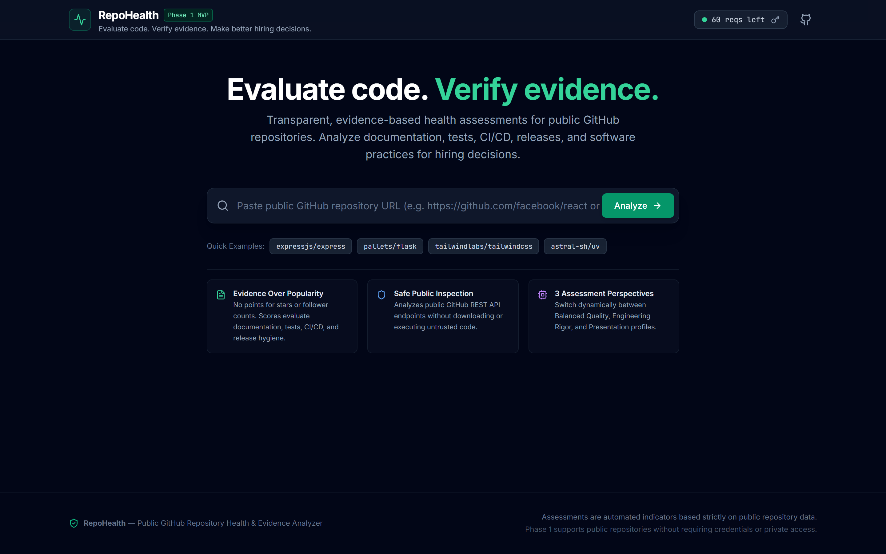
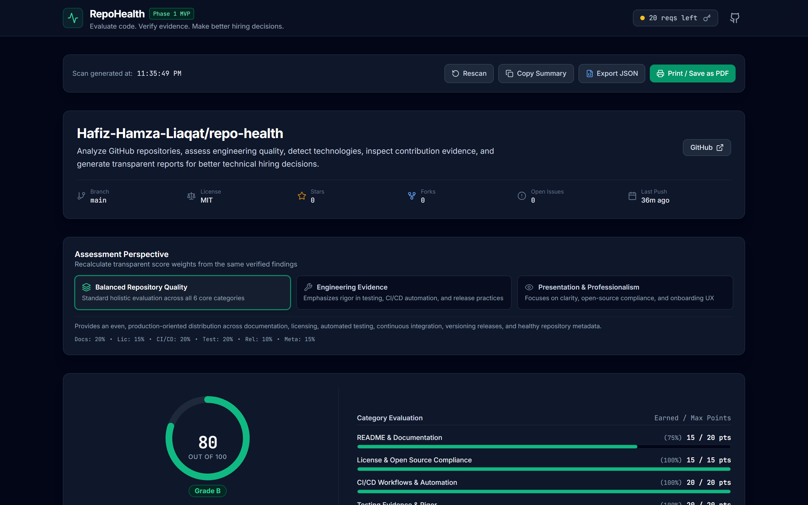
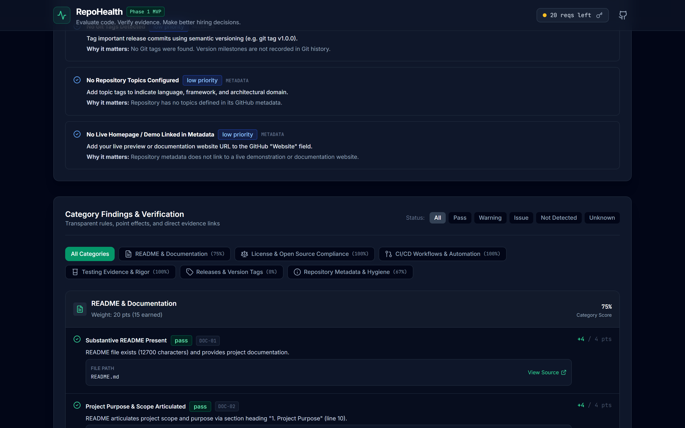

# RepoHealth

**Tagline:** *Evaluate code. Verify evidence. Make better hiring decisions.*  
**GitHub Repository:** [repo-health](https://github.com/Hafiz-Hamza-Liaqat/repo-health)

**Product Version:** `2.0.0 (Phase 2 Portfolio Readiness & GitHub Pages Deployment)`

**License:** [MIT](LICENSE)

**Target Deployment:** [GitHub Pages](https://hafiz-hamza-liaqat.github.io/repo-health/) *(Deployed via GitHub Actions on `main`)*

---

## 1. Project Purpose

RepoHealth is a professional GitHub repository health and developer evidence analyzer. It helps companies, technical recruiters, hiring managers, agencies, clients, and engineering teams assess public GitHub repositories using verifiable evidence.

Rather than relying on popularity metrics (such as GitHub stars, forks, or superficial follower counts) or assuming that code is high quality simply because a repository has a README, RepoHealth performs deterministic analysis across six core engineering categories:

- **Documentation Depth:** Detects project purpose, setup instructions, web-application user workflows supported by verified repository screenshots or library code usage examples, testing guidance, and live deployment links via an ATX heading parser stripping leading numbering and punctuation without false warnings.
- **License Compliance:** Identifies standard SPDX licenses, standalone root `LICENSE` documents, and unambiguous commercial distribution rights.
- **CI/CD Automation:** Verifies GitHub Actions workflow configurations, triggers (`push`, `pull_request`, `schedule`), and recent workflow execution status (passing vs. failing).
- **Testing Evidence:** Discovers test infrastructure, manifest scripts, and tracked test files recursively via GitHub's Git Trees API (`test/`, `tests/`, `src/test/`, `*.test.ts`, `*.test.tsx`, `*.spec.ts`, `*.spec.tsx`, etc.), recognizing nested and co-located test structures without requiring a root folder.
- **Release Cadence:** Distinguishes official GitHub releases with changelogs and semver tags from raw Git tags.
- **Repository Metadata:** Evaluates description clarity, topic discovery, default branch hygiene, and maintenance recency, cross-validating `size: 0 KB` with active content to eliminate false empty-repository warnings.
- **Technology Stack Detection:** Discovers frameworks, runtimes, and libraries across Languages, Frontend, Backend, Databases, DevOps, and Testing with confidence levels (`strongly_evidenced`, `detected`, `config_or_dependency_only`, `inferred`).
- **Defensible Provenance Signals:** Analyzes contributor distribution, bot activity (Dependabot, Renovate), and explicit AI tooling artifacts (`.cursorrules`, Copilot instructions) without speculative AI-authorship claims.

RepoHealth values demonstrable engineering practices. Scores are transparent, reproducible, and explainable.

---

## 2. Screenshot Gallery

A visual walkthrough of RepoHealth scanning `Hafiz-Hamza-Liaqat/repo-health`:

### Homepage & Repository Scanner

*Figure 1: Clean, high-contrast dark dashboard featuring the repository input field, quick example presets, and real-time GitHub API rate-limit monitor.*

### Repository Overview & Scoring Perspectives

*Figure 2: Comprehensive repository health overview displaying letter grade (A+), dynamic perspective switcher, score breakdown, technology stack badges, and prioritized recommendations.*

### Category Findings & Evidence Verification

*Figure 3: Detailed findings breakdown across all six assessment categories with stable rule IDs, granular point adjustments, status filters, and verified evidence links.*

---

## 3. How to Use RepoHealth

RepoHealth provides a transparent, client-side evaluation workflow:

1. **Enter a Public GitHub Repository URL:**
   Enter a full GitHub URL (e.g., `https://github.com/Hafiz-Hamza-Liaqat/repo-health`) or shorthand `owner/repo` (e.g., `facebook/react`) into the scanner input on the homepage, or pick one of the quick example presets.
2. **Start the Scan and Wait for GitHub API Results:**
   Click **Analyze** (or press Enter). RepoHealth connects directly to the GitHub REST API and advances through genuine network stages with real-time visual progress:
   - Repository Metadata & Health Indicators
   - Documentation & Heading Classification
   - CI/CD Workflows & Recent Execution Runs
   - Recursive Test Discovery via Git Trees API
   - Releases, Tags & Version Recency
   - Technology Stack & Provenance Synthesis
3. **Switch Between Assessment Perspectives:**
   Tailor the evaluation to your specific review context by toggling among three dynamic scoring perspectives:
   - **Balanced Repository Quality:** Balanced holistic evaluation across all 6 core categories (base 100 points).
   - **Engineering Evidence:** Emphasizes technical rigor, shifting **60% of total weight** to Automated Testing (30 pts) and CI/CD Automation (30 pts).
   - **Presentation & Professionalism:** Emphasizes developer onboarding, shifting **70% of total weight** to Documentation (30 pts), Licensing (25 pts), and Metadata (15 pts).
4. **Inspect Category Scores, Evidence-Backed Findings, and Recommendations:**
   - Review overall letter grade (A+ through F) and normalized score gauges.
   - Filter findings by status (**Pass**, **Warning**, **Issue**, **Not Detected**, **Unknown**) across all six categories.
   - Inspect detected technologies and confidence levels.
   - Review prioritized remediation items grouped by severity (High, Medium, Low).
5. **Export the Findings as JSON or Print/Save as PDF:**
   - Click **Export JSON** to download the complete versioned `RepoHealthReport_v1.1` specification.
   - Click **Copy Summary** to place a formatted Markdown summary on your clipboard.
   - Click **Print / PDF** to trigger the browser print dialog with dedicated print stylesheets that strip all navigation controls, forms, and interactive buttons for a clean executive summary report.

> **Scope Notice:** RepoHealth currently evaluates public repositories directly from the browser without requiring a user account or server-side database. Private repository analysis requires OAuth authentication and a secure backend gateway planned for a subsequent release.

---

## 4. Key Features

- **Zero-Authentication Public Scans:** Evaluates public repositories immediately without requiring GitHub login, server-side database, or private credentials.
- **Real-Time Step-by-Step Progress:** Visual progress tracker representing genuine network stages (Metadata → Documentation → CI/CD → Tests → Releases → Technology Synthesis).
- **Independent Deterministic Scoring Engine:** Decoupled calculation logic with 6 assessment categories, stable rule identifiers (`DOC-01`–`DOC-06`, `LIC-01`–`LIC-03`, `CI-01`–`CI-03`, `TST-01`–`TST-04`, `REL-01`–`REL-03`, `META-01`–`META-05`), and zero synthetic points.
- **Three Dynamic Assessment Perspectives:** Balanced Repository Quality, Engineering Evidence, and Presentation & Professionalism.
- **Transparent Denominator Normalization:** When an optional category is not applicable, the denominator adjusts proportionally without penalizing the repository.
- **Comprehensive Finding Status Accounting:** Displays all 5 finding statuses (Pass, Warning, Issue, Not Detected, Unknown) reconciling exactly with total evaluated rules.
- **Data Coverage Separation:** Explicitly distinguishes endpoint query accounting (e.g. `10/10 responses`) from repository tree coverage completeness and absent optional resources.
- **Recursive Test Discovery:** Leverages GitHub's Git Trees API to discover nested test suites (`src/test/`, `src/analyzers/*.test.ts`, etc.) and test runners without requiring a root-level test directory.
- **Web Application & Library Evidence Recognition:** Recognizes both frontend web applications (workflow steps + verified repository screenshots) and backend/CLI libraries (code usage examples) fairly under `DOC-04`.
- **Prioritized Action Items:** Actionable recommendations categorized by severity (High, Medium, Low) with direct rationale.
- **Export & Sharing Options:** Versioned JSON export, Markdown summary clipboard copy, and dedicated print/PDF stylesheet.
- **Memory-Only Token Option:** Store an optional GitHub Personal Access Token strictly in JavaScript memory (never written to `localStorage` or `sessionStorage`) to elevate the hourly limit from 60 to 5,000 requests/hr during intense evaluation sessions.
- **Session Caching:** In-memory request cache with 15-minute TTL eliminates redundant requests.

---

## 5. Technology Stack

- **Frontend Framework:** React 18 with TypeScript (strict mode: `strict: true`, `noUnusedLocals: true`, `noUnusedParameters: true`)
- **Build Tool:** Vite 6 with dual-mode base configuration (local `/` vs. GitHub Pages `/repo-health/`)
- **Styling:** Tailwind CSS with responsive dark slate theme and custom print stylesheets
- **Icons:** Lucide React
- **API Client:** GitHub REST API v3 with rate-limit tracking, session caching, and tree-based recursive queries
- **Testing:**
  - **Vitest & React Testing Library:** 68 automated unit, analyzer, engine, service, and component tests across 6 test files
  - **Playwright:** 3 critical browser end-to-end user workflows
- **Code Quality:** ESLint (`@typescript-eslint`), Prettier, TypeScript compiler (`tsc --noEmit`)
- **CI/CD:** GitHub Actions workflow executing quality checks and automated deployment to GitHub Pages

---

## 6. Architecture Overview

```
src/
├── types/                # Domain schemas (GitHub, Scoring, Technology, Analysis, Report)
├── config/               # Centralized scoring profiles, stable rule definitions, example repos
├── services/             # GitHub REST API client, session cache, rate-limit tracker
├── analyzers/            # Modular analyzers
│   ├── urlParser.ts      # Validates full URLs, shorthand owner/repo, rejects foreign domains
│   ├── readmeAnalyzer.ts # Evaluates purpose, setup, usage/workflows, screenshots, testing, demos
│   ├── licenseAnalyzer.ts# Evaluates SPDX identifiers, root file presence, distribution clarity
│   ├── workflowAnalyzer.ts # Evaluates GitHub Actions, triggers, and execution status
│   ├── testingAnalyzer.ts# Evaluates test runner configs, scripts, directories, CI integration
│   ├── releasesAnalyzer.ts # Distinguishes releases with changelogs from raw Git tags
│   ├── metadataAnalyzer.ts # Evaluates description, topics, default branch, maintenance recency
│   ├── technologyDetector.ts # Modular tech rules (Languages, Frontend, Backend, DevOps, etc.)
│   └── provenanceAnalyzer.ts # Contributor distribution, bot activity, explicit AI tooling
├── engine/               # Independent business logic
│   ├── scoringEngine.ts  # Deterministic score calculator, denominator normalization
│   ├── recommendations.ts# Synthesizes issues and warnings into prioritized action items
│   └── reportGenerator.ts# Assembles the typed, exportable RepoHealthReport
├── utils/                # Sanitization (safe base64 decoding), date/number formatters, export
└── components/           # UI presentation layer
    ├── layout/           # Header, Footer, ApiSettingsModal
    ├── scanner/          # ScanForm, ScanProgress, ExamplePicker
    ├── dashboard/        # DashboardHeader, ScoreOverview, PerspectiveSelector, CategoryCards,
    │                     # TechnologyBadges, ProvenanceOverview, RecommendationsList, LimitationsNotice
    ├── common/           # Badge, ScoreGauge
    └── print/            # Dedicated print report stylesheet
```

---

## 7. Scoring Methodology

The baseline assessment engine is structured around **six assessment categories** totaling 100 points:

| Category | Base Weight | Stable Rule IDs | Key Evidence Evaluated |
| :--- | :--- | :--- | :--- |
| **README & Documentation** | 20 pts | `DOC-01` to `DOC-06` | README presence, architecture overview, setup commands, usage workflow/code examples, testing instructions, demo links. |
| **License Compliance** | 15 pts | `LIC-01` to `LIC-03` | Recognized SPDX identifier, physical root `LICENSE` file, unambiguous commercial distribution rights. |
| **CI/CD Workflows** | 20 pts | `CI-01` to `CI-03` | GitHub Actions definitions in `.github/workflows`, automated triggers, verified passing recent runs. |
| **Testing Evidence** | 20 pts | `TST-01` to `TST-04` | Recognized test runner (Vitest, Jest, Playwright, pytest, etc.), manifest test scripts, recursive test directories. |
| **Releases & Version Tags** | 10 pts | `REL-01` to `REL-03` | Formal published GitHub releases with release notes, Git semver tags, release recency. |
| **Repository Metadata** | 15 pts | `META-01` to `META-05` | Repository description, topics tags, default branch hygiene, homepage link, maintenance recency. |

### Dynamic Assessment Perspectives

Users can switch assessment perspectives instantly to recalculate the score without modifying underlying findings:

1. **Balanced Repository Quality:** Base weights `[20, 15, 20, 20, 10, 15]` = 100 pts.
2. **Engineering Evidence:** Emphasizes testing rigor and automated delivery:
   - Testing Evidence: **30 pts**
   - CI/CD Workflows: **30 pts**
   - Releases & Tags: **10 pts**
   - Documentation: **10 pts**
   - License: **10 pts**
   - Metadata: **10 pts**
   - *Total: 100 pts*
3. **Presentation & Professionalism:** Emphasizes open-source clarity, portfolio UX, and onboarding:
   - Documentation: **30 pts**
   - License: **25 pts**
   - Repository Metadata: **15 pts**
   - CI/CD Workflows: **10 pts**
   - Testing Evidence: **10 pts**
   - Releases & Tags: **10 pts**
   - *Total: 100 pts*

### Letter Grades
- **A+:** 95–100 points
- **A:** 85–94 points
- **B:** 70–84 points
- **C:** 50–69 points
- **D:** 35–49 points
- **F:** < 35 points

---

## 8. Setup and Development Commands

### Prerequisites
- Node.js `v18+` or `v20+` (tested on Node `v22.21.1`)
- npm `v9+` or `v10+`

### Installation
```bash
# Clone the repository
git clone https://github.com/Hafiz-Hamza-Liaqat/repo-health.git
cd repo-health

# Install dependencies
npm install
```

### Local Development
```bash
# Start local development server with Hot Module Replacement (HMR)
npm run dev
```
Open `http://localhost:5173` in your browser.

### Verification and Quality Commands
```bash
# 1. Type check TypeScript codebase in strict mode
npm run typecheck

# 2. Lint TypeScript and React source files (zero warnings allowed)
npm run lint

# 3. Run all unit and integration tests (Vitest: 68 tests across 6 files)
npm run test

# 4. Run Vitest in interactive watch mode
npm run test:watch

# 5. Run end-to-end browser journeys (Playwright)
npm run test:e2e

# 6. Compile production bundle for local hosting
npm run build

# 7. Compile production bundle for GitHub Pages hosting
GITHUB_PAGES=true npm run build

# 8. Preview production build locally
npm run preview
```

---

## 9. GitHub Pages Deployment

RepoHealth is configured for automated continuous deployment to **GitHub Pages** via GitHub Actions.

- **Expected Live URL:** `https://hafiz-hamza-liaqat.github.io/repo-health/`
- **CI/CD Pipeline File:** `.github/workflows/main.yml`

### Deployment Architecture

1. **Dual-Mode Vite Configuration:**
   In `vite.config.ts`, the base path dynamically adapts based on the build target:
   - Local development and standard builds: `base: '/'`
   - GitHub Pages production builds: `base: '/repo-health/'` (enabled when `GITHUB_PAGES=true`)
2. **Dependent Pipeline Stages:**
   The GitHub Actions workflow consists of two sequential jobs:
   - `quality-checks`: Runs `npm ci`, `typecheck`, `lint`, `test`, `test:e2e`, and `build`.
   - `deploy`: Runs on pushes to `main` only after `quality-checks` succeeds. It builds with `GITHUB_PAGES: "true"` and uses official GitHub Pages actions (`actions/configure-pages@v6`, `actions/upload-pages-artifact@v5`, `actions/deploy-pages@v5`).
3. **Least-Privilege Permissions:**
   The deployment job requests only required permissions: `contents: read`, `pages: write`, and `id-token: write`.

### GitHub Pages Activation Steps

To enable automated deployment on GitHub:

1. Navigate to the repository on GitHub: `https://github.com/Hafiz-Hamza-Liaqat/repo-health`.
2. Go to **Settings** → **Pages** (under Code and automation).
3. Under **Build and deployment** → **Source**, select **GitHub Actions**.
4. Pushing new commits to the `main` branch will automatically execute `.github/workflows/main.yml` and publish the site.

---

## 10. API Limitations & Rate Limits

- **Public Unauthenticated Limit:** The GitHub REST API permits **60 requests per hour** per IP address.
- **Memory Token Upgrade:** Users can click the key icon in the navigation bar to provide an optional Personal Access Token (held strictly in JavaScript memory during the active session), which immediately upgrades their rate limit to **5,000 requests per hour**.
- **Graceful Partial Results:** If secondary endpoints fail (e.g., GitHub Actions runs endpoint returns 403 or 404), RepoHealth does not crash; it logs the reduced coverage and calculates the score with clear limitation notes.

---

## 11. Privacy & Security Considerations

- **Untrusted Content Safety:** All text extracted from repositories and README files is treated as untrusted data and sanitized to prevent script injection.
- **No Code Execution:** Repository code is analyzed strictly via metadata, structure, and file contents. No repository code is downloaded or executed locally.
- **Credential Safety:** RepoHealth contains no hardcoded tokens, client secrets, or private keys. Optional user-provided tokens are held solely in JavaScript memory for the current browser session (never written to `localStorage` or `sessionStorage`) and are discarded on tab close or page reload.

---

## 12. Current Limitations & Roadmap

### Phase 2 Scope & Limitations
- **Public Repositories Only:** Exclusively analyzes public GitHub repositories.
- **Static Structural Inspection:** Evaluates test infrastructure and test files; does not execute test suites or measure runtime test coverage percentages.
- **Defensible AI Signals:** Reports explicit AI configuration files (`.cursorrules`, Copilot instructions) or documentation acknowledgments rather than guessing speculative AI-generated percentages.

### Roadmap
- **Phase 3:** Deep commit history, pull-request review velocity, and contributor collaboration graphs.
- **Phase 4:** Candidate skill evidence matrices and technical interview question generation.
- **Phase 5:** Multi-repository side-by-side comparison and historical health tracking.
